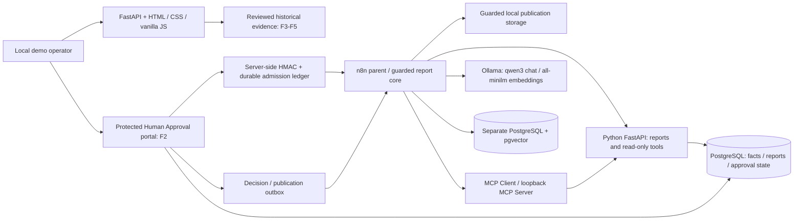

# Retail Analytics Automation

A local portfolio showcase for AI and business automation: turn historical retail
transactions into traceable reports, human decisions and controlled publication.

**Published release:** 296 approved files, including six screenshots and the demo
video. Local CI-equivalent checks passed with 56 pytest tests;
[hosted GitHub Actions passed](https://github.com/Eugene156/retail-analytics-automation/actions/runs/41794810154).


## Business problem

Retail analysis needs more than a generated answer. Sales calculations must be
consistent, cancellation rows must be distinguished from data-quality errors, and
published reports must match the version a person reviewed. This project combines
SQL-owned facts, bounded AI tools, document retrieval and explicit human approval
in one small local website.

The business context is an analyst exercise over historical data. No production
adoption, measured time savings or ROI is claimed. Reviewers can assess the code,
architecture and evidence without installing the system.

## Six implemented website sections

All six pages have passed local functional checks and owner visual review.

| Section | What the visitor can inspect | Execution mode |
| --- | --- | --- |
| F1 · Overview | Project modules, verified implementation status and technology stack | Local navigation and saved evidence |
| F2 · Human Approval | Create a report, inspect its exact contract, sign in as owner, approve or reject, inspect publication receipts | Controlled real local actions; approval is separate from creation |
| F3 · AI Agent | Select Sales KPIs, Data Quality or Combined; inspect answers, actual tool calls and execution references | Verified historical P2 results |
| F4 · MCP Analytics | Select Sales KPIs or Combined; inspect MCP discovery/calls, read-only tool results and the final answer | Verified historical P3 results |
| F5 · Knowledge Assistant | Select three policy questions; inspect retrieved excerpts, source IDs, citations and answers | Verified historical P4 RAG results |
| F6 · API & CI | Explore API contracts, test categories, configured CI, logging and downloadable developer artifacts | Implementation artifacts and recorded local verification |

F3–F5 selectors do not invoke an LLM or start a workflow. Raw technical payloads
are collapsed; evidence remains available for inspection.

## Architecture and stack



This diagram covers the existing local workflows as well as the website. Opening
an evidence page does not traverse the live AI paths.

- **Orchestration:** n8n parent/core workflows, native AI Agent, real tool calling
  and supported MCP Client Tool. Docker Compose isolates the local demo services.
- **Facts and contracts:** Python/FastAPI, PostgreSQL and SQL NUMERIC arithmetic.
  Tools expose bounded read-only analytics; no arbitrary SQL, shell or URL access.
- **Human control:** owner sessions, Host/Origin/CSRF guards, HMAC-signed creation
  admission and a PostgreSQL nonce/operation ledger. Creation grants no approval
  authority. Approval binds report version/hash, reviewer, target and expiry;
  outbox delivery and receipts guard publication and duplicates.
- **RAG:** chunked KPI/business-policy documents, real local embeddings and
  pgvector similarity search before the agent. Source IDs are validated; exact
  quotations are assembled from retrieved chunks rather than copied by the model.
- **Engineering:** structured outputs and evidence guards, offline AI evaluation,
  GitHub Actions configuration, OpenAPI/Postman and structured HTTP logging.

Models cannot approve or publish reports. Original model output and deterministic
validated output are distinguished: required P2/P3 numeric lines come from actual
tool responses, not unsupported model prose.

## Local demonstration

These URLs refer to an **already provisioned owner environment**, not a public
hosted demo. Fresh-machine setup has not been verified. Workflow templates alone
do not provision data, credentials, database permissions or services.

1. Open [Overview](http://127.0.0.1:18090/overview) and use the sidebar.
2. Open [Human Approval](http://127.0.0.1:18082/portal/f2). Sign in manually through
   the protected owner portal. Review existing requests without creating state.
   A new Create/Approve/Reject demonstration requires explicit owner authorization;
   publication is restricted to the isolated local target.
3. In [AI Agent](http://127.0.0.1:18090/overview#ai-agent),
   [MCP Analytics](http://127.0.0.1:18090/overview#mcp-analytics) and
   [Knowledge Assistant](http://127.0.0.1:18090/overview#knowledge-assistant),
   select a saved scenario, read the answer, then expand its tool/source evidence.
4. Open [API & CI](http://127.0.0.1:18090/overview#api-ci) for API examples and
   developer artifacts. [n8n](http://127.0.0.1:15690) provides authenticated
   workflow/execution inspection; opening it does not require running a workflow.

Never include owner tokens, credentials, raw execution exports or private runtime
files in recordings or commits. P2 API and P3 MCP currently use detached processes
that may need restoration after their containers stop. Run local model work
sequentially on memory-limited machines.

## Verified tests and evidence

| Scope | Recorded result | Qualification |
| --- | --- | --- |
| F2 acceptance | Create → owner Approve → PUBLISHED; separate Create → owner Reject → REJECTED | Real isolated local cases; receipt/hash and absence of rejected publication verified |
| P2 / P3 / P4 live AI | Eight scenarios passed after two Combined repairs | Historical local runs; P2 #104 and P3 #106 also reviewed manually |
| Release CI verification | 56 pytest tests passed locally against the approved release set; hosted GitHub Actions passed | Selected offline checks; not total test coverage or live integration testing |
| Latest F2 presentation/navigation changes | 14 focused checks passed on 4 November 2026 | Isolated rendering/authentication/CSRF/query regressions; subsequent live read-only checks and owner visual review |

See the [live-validation receipt](evidence/p6_live_validation.json),
[Combined repair receipt](evidence/p6_combined_repair.json),
[AI evaluation methodology](docs/AI_EVALUATION.md) and
[evaluation report](docs/AI_EVALUATION_REPORT.md).
The evaluation report replays eight reviewed historical cases with explicit
Tool Selection Accuracy, bounded Factual Correctness, Citation Validity, Schema
Compliance and Pass Rate denominators. N/A is excluded. These results are a small
retrospective diagnostic set, not a general model-quality benchmark.

## CI and developer tools

[GitHub Actions](.github/workflows/ci.yml) configures Python 3.12 checks on push,
pull request and manual dispatch, with read-only repository permissions and a
five-minute timeout. It runs publication/static checks and six selected pytest
modules covering recovery policy, workflow helpers, publication privacy, offline
AI evaluation, API artifacts and synthetic logging. Live inference and deployment
are excluded. **Hosted GitHub Actions passed; automatic CD is not implemented.**

Commands matching the current configuration:

```sh
python -m pip install -r config/ci-requirements.txt
python scripts/check_publication.py
python -m pytest -q tests/test_wp4_recovery_design.py tests/test_wp3_n8n_local.py tests/test_publication_security.py tests/test_ai_evaluation.py tests/test_api_docs.py tests/test_observability.py
python scripts/evaluate_ai_demo.py
```

The approved 296-file release set passed publication/static/YAML checks and all
56 configured pytest tests in an isolated local environment. The published initial
commit also passed the hosted GitHub Actions workflow linked above.

[API guide](docs/API_DEMO_GUIDE.md), [OpenAPI projection](docs/openapi_demo.json),
[Postman collection](docs/postman_collection.json) and
[blank environment](docs/postman_environment.template.json) describe eight
reviewed API paths and ten requests. Examples are synthetic, secrets use variables,
and the state-changing request is marked and skipped by default. Built-in runtime
Swagger/ReDoc are disabled; Postman GUI execution remains unverified.

The main and P2 APIs emit bounded JSON completion logs and server-generated
`X-Request-ID` values. Headers, bodies, query strings and credentials are omitted.
The historical live receipt records matching response/log IDs. This is HTTP
correlation, not distributed tracing; approval, MCP and Ollama do not share a
propagated trace. A synthetic example needs no running service:

```sh
python -m api.observability --demo
```

## Screenshots and video

Six published screenshots have been visually reviewed for visible secrets and private information:

| Section | Screenshot |
| --- | --- |
| F1 Overview | [Overview](media/01-overview.png) |
| F2 Human Approval | [Human Approval](media/02-human-approval.png) |
| F3 AI Agent | [AI Agent](media/03-ai-agent.png) |
| F4 MCP Analytics | [MCP Analytics](media/04-mcp-analytics.png) |
| F5 Knowledge Assistant | [Knowledge Assistant](media/05-knowledge-assistant.png) |
| F6 API & CI | [API & CI](media/06-api-ci.png) |

[Watch or download the demonstration video](media/Retail_Analytics_Automation_Demo_GitHub.mp4)
(MP4, 1 minute 51 seconds, 3.98 MiB).

The owner reports independent review of 37 distinct frames sampled sequentially
at 3-second intervals across the video. All six sections are visible; no passwords
or authentication tokens were identified in those frames. Demo request IDs and
report hashes are visible. This is representative sampling, not exhaustive
frame-by-frame privacy verification. Screenshots and the demo video are published;
hosted video playback has not been verified.

## Known limitations and release boundaries

- This is a local portfolio demonstration, not a production service. Current
  website AI results are saved evidence, not fresh availability guarantees.
- Fresh-machine bootstrap and Postman GUI use remain unverified. Local and hosted
  CI success does not establish fresh-machine deployment or recovery readiness.
- Fixed Docker IP allowlisting remains a reliability improvement; container address
  changes can interrupt publication delivery. Uncertain outcomes require durable
  reconciliation before retrying.
- RAG uses a small policy corpus and bounded answer checks. Broad retrieval
  quality, hostile-input resilience and live abstention are not benchmarked.
- Credentials, sessions, original datasets, database volumes, raw execution history
  and recovery backups stay private. No dataset/model/runtime redistribution is
  intended. Third-party components and dataset rights retain their separate licenses.

## License and dataset attribution

Original project code and documentation are licensed under the [MIT License](LICENSE),
copyright (c) 2026 Eugene156. Third-party software, datasets and model weights
retain their own licenses; the complete runtime stack is not licensed as MIT.
See [third-party notices](THIRD_PARTY_NOTICES.md) for component boundaries.

The verified demonstrations use Chen, D. (2012), *Online Retail II*, UCI Machine
Learning Repository, DOI [10.24432/C5CG6D](https://doi.org/10.24432/C5CG6D), under
[CC BY 4.0](https://creativecommons.org/licenses/by/4.0/).
The project maps and classifies source rows, selects overlapping worksheet periods
analytically, and computes aggregate KPIs/reports. Original source rows are
preserved locally; raw data is excluded from publication. Attribution and
transformation details are in [the notices](THIRD_PARTY_NOTICES.md#dataset-attribution).

[KPI dictionary](docs/KPI_DICTIONARY.md) · [Data contract](docs/DATA_CONTRACT.md) ·
[Business analysis](docs/BUSINESS_ANALYSIS.md) ·
[Source and third-party notices](THIRD_PARTY_NOTICES.md) ·
[Publication selection](docs/PUBLICATION_MANIFEST.md)
