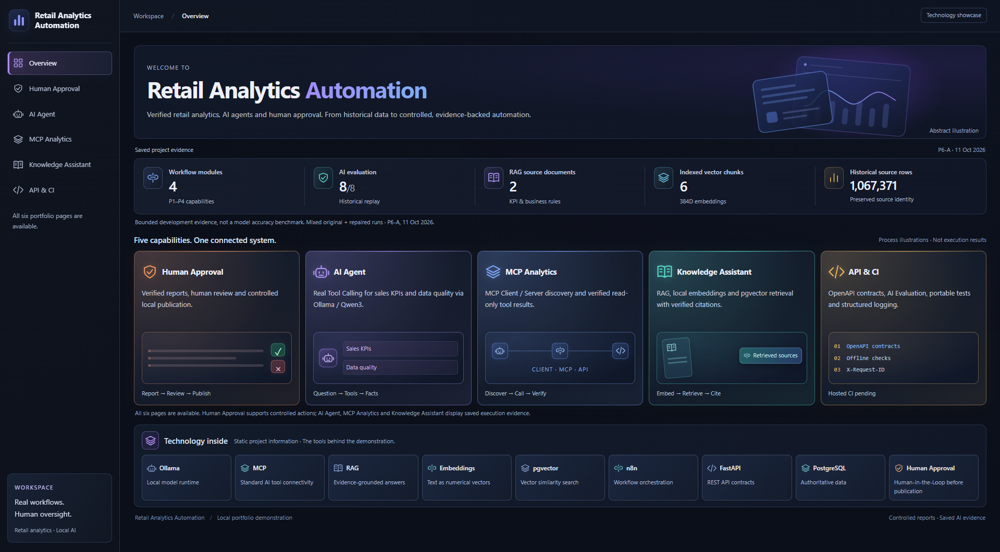
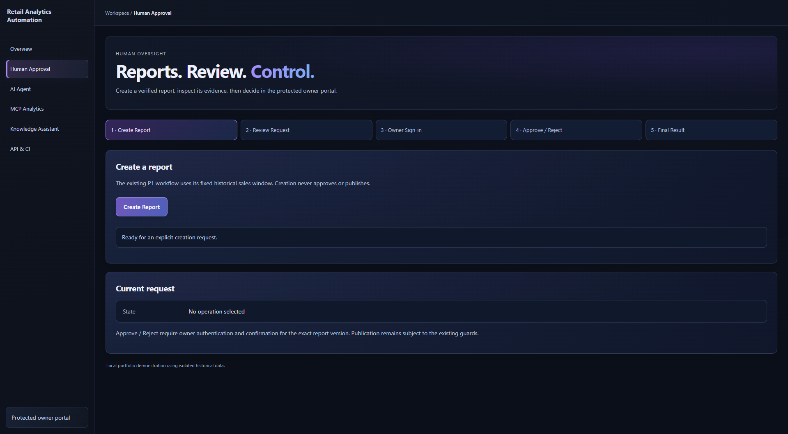
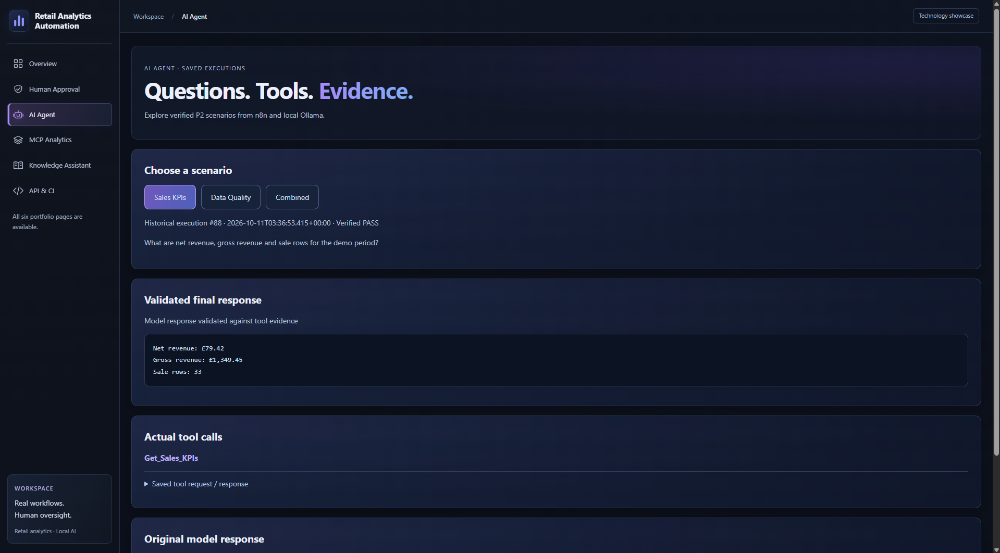
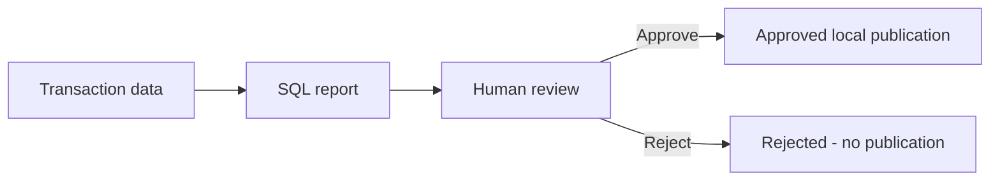

# Retail Analytics Automation

A Business Analyst / System Analyst and AI Automation portfolio connecting
business requirements, reliable retail calculations and human-controlled decisions.

The business problem: reports need consistent figures, clear KPI definitions and
traceable review before publication. This project combines SQL reporting,
AI-assisted analysis and explicit owner approval over historical retail data.

**The public demo is the video and screenshots. The interactive website is local-only.**
No installation is needed to review the portfolio.

**[Watch the demo video](media/Retail_Analytics_Automation_Demo_GitHub.mp4)**
— 1 minute 51 seconds · MP4 · 3.98 MiB.

## Start Here — Business & System Analysis

| Artifact | What it demonstrates |
| --- | --- |
| [Business analysis](docs/BUSINESS_ANALYSIS.md) | Problem, illustrative AS-IS, delivered TO-BE, decisions and assumptions |
| [Requirements matrix](docs/REQUIREMENTS_MATRIX.md) | Traceability, evidence and explicit delivery gaps |
| [Acceptance criteria](ACCEPTANCE.md) | Review rules, acceptance outcomes and original criteria |
| [KPI dictionary](docs/KPI_DICTIONARY.md) | Definitions, denominators and exclusions |
| [Architecture](#architecture-and-stack) | Reporting flow and system boundaries |

## My Role & AI Assistance

I set the project scope and business requirements, reviewed KPI definitions and
business rules, and reviewed acceptance criteria before making acceptance decisions.
I manually checked Approve/Reject behavior, reviewed published results, and reviewed
AI/tool outputs and website functionality.

Codex/AI assisted with coding, automated testing and documentation. This is a
personal portfolio exercise using historical data, rather than a client engagement.
[Business context and evidence boundaries](docs/BUSINESS_ANALYSIS.md).

## Key Capabilities

- **Reliable reporting:** SQL calculates sales and quality metrics with precise money arithmetic.
- **Human review:** the owner approves or rejects the exact report before publication.
- **AI analysis:** an agent selects real read-only sales and data-quality tools.
- **MCP integration:** client/server discovery connects the agent to analytics tools.
- **Grounded answers:** RAG retrieves policy excerpts with validated sources and citations.

## Six implemented website sections

F = website section; P = backend capability; WP = development work package.

| Section | What it shows |
| --- | --- |
| F1 · Overview | Project capabilities, stack and saved evidence |
| F2 · Human Approval | Controlled local report creation, owner decisions and publication receipts |
| F3 · AI Agent | Three saved P2 scenarios with actual tool calls and answers |
| F4 · MCP Analytics | Two saved P3 scenarios with MCP tools and results |
| F5 · Knowledge Assistant | Three saved P4 questions with retrieved excerpts and citations |
| F6 · API & CI | API contracts, engineering checks and developer artifacts |

F3-F5 display verified historical executions; selecting a scenario does not run an LLM.
The underlying local workflows were tested separately from these evidence views.

## Human Approval

The owner reviews the report and decides; creating it never implies approval.

## AI Agent

Tool results and the validated answer are shown separately for inspection.

More screenshots: [MCP Analytics](media/04-mcp-analytics.png) ·
[Knowledge Assistant](media/05-knowledge-assistant.png) · [API & CI](media/06-api-ci.png).

## Architecture and stack

PostgreSQL owns facts and state; n8n orchestrates workflows; FastAPI exposes bounded
contracts. Ollama supplies local inference/embeddings, and pgvector supports retrieval.
The website uses HTML, CSS and vanilla JavaScript; Docker Compose isolates services.

AI tools are read-only and cannot approve or publish. See the
[detailed architecture and security boundaries](docs/TECHNOLOGY_ROADMAP.md#architecture-and-engineering-boundaries)
for the full component diagram, authentication and delivery controls.

## Verified tests and evidence

| Scope | Recorded outcome |
| --- | --- |
| Human Approval | Owner Approve → PUBLISHED; separate Reject → REJECTED without publication |
| AI / MCP / RAG | Eight locally verified scenarios across the three capabilities |
| Release verification, 4 November 2026 | Publication/static/YAML checks and **56 pytest tests passed locally**; hosted CI passed |

The test count is a recorded verification result, not a promise about every future
commit. The badge and [workflow history](https://github.com/Eugene156/retail-analytics-automation/actions/workflows/ci.yml)
show current CI status. No new tests were run for this README edit.

Evidence: [Human Approval](evidence/p12_human_approval.json),
[initial live checks](evidence/p6_live_validation.json) and
[completed tool-fact checks](evidence/p6_combined_repair.json).
The initial receipt retains failures; the later receipt completes the eight-case result.
[AI evaluation](docs/AI_EVALUATION_REPORT.md) documents tool selection, factual checks,
source validity and schema checks on a small development set, not a general benchmark.

## Technical Documentation

- [API, OpenAPI/Postman, CI commands and logging](docs/API_DEMO_GUIDE.md)
- [Published n8n workflow inventory](workflows/README.md)
- [Evaluation methodology](docs/AI_EVALUATION.md) and [data-source clarification](docs/DEMO_AND_GITHUB.md#pinned-policy-documents-and-current-status)

## Local demonstration

For the already provisioned owner environment, see the
[local addresses and demonstration guidance](docs/DEMO_AND_GITHUB.md#local-demonstration-addresses).

## Known limitations and release boundaries

- Fresh-machine deployment/recovery and Postman GUI execution remain unverified;
  importing workflows does not provision data, services or credentials.
- Fixed Docker IP allowlisting can interrupt delivery after address changes;
  uncertain outcomes require reconciliation before retrying.
- RAG uses a small policy corpus. Broad retrieval quality, hostile-input resilience
  and live abstention are not benchmarked. No production adoption or measured ROI is claimed.
- Original datasets, credentials, runtime state and raw execution history remain private.
  CI performs offline checks, not live AI validation or automatic deployment.

Media review covered all six screenshots and, as reported by the owner, 37 sampled
video frames. No passwords/tokens were identified in those samples; demo IDs and
hashes are visible. Sampling was not exhaustive; hosted video playback is unverified.

## License and Data Attribution

Original code/documentation: [MIT License](LICENSE), copyright (c) 2026 Eugene156.
Third-party software, data and model weights retain their own licenses.

Data: Chen, D. (2012), *Online Retail II*, UCI Machine Learning Repository,
DOI [10.24432/C5CG6D](https://doi.org/10.24432/C5CG6D), [CC BY 4.0](https://creativecommons.org/licenses/by/4.0/).
The project maps/classifies rows, selects overlapping worksheet periods analytically
and aggregates KPIs; original source rows remain preserved locally.
[Attribution and transformations](THIRD_PARTY_NOTICES.md) · [Publication inventory](docs/PUBLICATION_MANIFEST.md).
